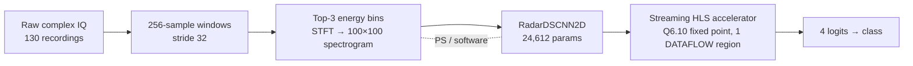

# KV260 Radar DS-CNN Accelerator

Micro-Doppler radar target classification (**Drone / Bird / Human / Corner Reflector**)
with a compact depthwise-separable CNN, implemented as a custom fixed-point
**streaming HLS accelerator** on the AMD Kria **KV260** (K26, `xck26-sfvc784-2LV-c`).
The repository also has a Vitis AI DPU deployment path for comparison.



## Highlights

| | Result | Evidence |
|---|---|---|
| Validation | Grouped 5-fold, **recording-disjoint** (0 overlap): window acc **80.57 ± 2.98 %**, macro-F1 **66.45 ± 5.29 %**; recording acc **86.67 ± 11.18 %** | [`cross_validation_metrics.json`](outputs/recordwise_topk3_stride32_cv5_capped8/cross_validation_metrics.json) |
| Numerical match | Host-float kernel vs PyTorch ≤ 8.94e-7; fixed-point C-sim bit-exact at every stage | [`outputs/evidence/`](outputs/evidence/) |
| RTL co-simulation | **PASS, 112,020 cycles** (≈ 1.16 ms/frame, ~865 frames/s at ~97 MHz) | [`cosim.rpt`](6_hardware/hls/radar_cnn_hls_accel/reports/optimized_vitis2022_2/cosim.rpt) |
| System implementation | Zynq UltraScale+ block design, **timing met** (WNS +1.149 ns), LUT 84.3 %, DSP 48 %, BRAM 57.5 tiles, 0 URAM | [`6_hardware/vivado/optimized/`](6_hardware/vivado/optimized/) |
| Board run | Bare-metal benchmark app prepared; **not yet run on hardware** | [`7_deployment/kv260_baremetal/`](7_deployment/kv260_baremetal/) |

## How it evolved

1. **A score that was too good**: a plain CNN on a random window split scored 96.9 %.
   A recording-disjoint split dropped it to 43.7 %. Overlapping windows had been
   leaking between train and test.
2. **A model that holds up**: top-3 energy bins, a 24.6k-parameter DS-CNN and
   capped class weights. Grouped 5-fold reached 80.6 % with zero overlap.
3. **A design that didn't fit**: the frame-buffered HLS design needed 564 % of the
   BRAM. A streaming DATAFLOW rewrite plus three optimizations brought it to 57 BRAM.
4. **Two implemented systems**: a baseline at 100 MHz (224k cycles), then an
   unroll rebalance that halved latency to 112k cycles at ~97 MHz with more timing margin.

The full story with the evidence for each step is in [docs/project_history.md](docs/project_history.md).

## Repository layout

```text
1_data/            dataset notes and label maps (raw data is not redistributed)
2_preprocessing/   recording-disjoint windowing and spectrogram cache builder
3_training/        training and grouped cross-validation entry points
4_evaluation/      evaluation, comparisons, ONNX validation, plots
5_quantization/    Vitis AI quantization and KV260 DPU compilation
6_hardware/
  hls/radar_cnn_hls_accel/
    v1_frame_buffered/   numerical reference (does not fit the K26)
    v2_streaming/        streaming DATAFLOW accelerator (final design)
    reports/             csynth / cosim / place-and-route reports for every build
    golden/, tools/      golden vectors, weight exporter, comparators
  vivado/                routed timing / utilization / power reports, block designs, XSA
7_deployment/kv260_baremetal/   board benchmark app + generated HLS driver
src/radar2dcnn/    shared library: model, spectrogram, dataset, metrics
scripts/           single-purpose utilities (export, quantize, demos)
tests/             pytest unit tests
outputs/           curated experiment results, final checkpoint, ONNX, DPU xmodels
docs/              architecture, training, hardware, deployment, results
```

## Quick start

```bash
python -m venv .venv && source .venv/bin/activate      # Windows: .venv\Scripts\activate
pip install -r requirements_host.txt
python -m pytest                                       # unit tests

# 1. windows + recording-disjoint split (raw file path is yours)
python 2_preprocessing/make_recordwise_windows.py --input ../radar_data/radar_iq.npy \
       --range-mode topk_energy_mean --top-k 3 --stride 32        # writes outputs/recordwise/
# 2. train, evaluate, cross-validate
python 3_training/train_recordwise.py --model radar_dscnn2d --augmentation --imbalance-strategy capped --max-class-weight 8
python 4_evaluation/eval_recordwise.py
python 3_training/cross_validate_recordwise.py --cache-root outputs/recordwise
```

Run `--help` on any script for the full options. The HLS host check runs in seconds with plain `g++`:

```bash
cd 6_hardware/hls/radar_cnn_hls_accel/v2_streaming
g++ -std=c++17 -O2 -DRADAR_CNN_SOFTWARE_FLOAT -Wno-unknown-pragmas -o tb_stream tb_stream.cpp radar_cnn_stream.cpp
./tb_stream ../golden/input_samples.txt ../reports/fixed_point_validation/pytorch_reference.csv
```

For the full Vitis HLS / Vivado flow, see [docs/hardware.md](docs/hardware.md).

## Hardware results

| | Frame-buffered | Streaming baseline | **Streaming optimized** |
|---|---|---|---|
| HLS tool | Vitis 2025.1 | Vitis 2025.1 | Vitis 2022.2 |
| C-synth BRAM_18K / DSP | 1,625 (564 %) / 817 | 57 / 1,174 | 60 / 1,018 |
| Latency (measured cosim) | — (does not fit) | 224,411 cycles | **112,020 cycles** |
| System clock | — | 100 MHz | ~97 MHz |
| Routed LUT / DSP / BRAM tiles | — | 97,365 / 681 / 25.5 | **98,707 / 599 / 57.5** |
| Setup WNS | — | +0.068 ns | **+1.149 ns** |
| Vivado power estimate | — | 4.196 W | 3.712 W |
| Frame time | — | 2.24 ms | **≈ 1.16 ms** |

See [docs/results.md](docs/results.md) for the machine-learning results and how they were measured.

## Known limitations

- **The DPU path uses a different network.** The compiled xmodel (`outputs/real/compiled_kv260_dpu/`) and the ONNX check are for the earlier plain `Radar2DCNN`, trained on single max-energy-bin spectrograms. They are not the final DS-CNN, so they are not a like-for-like comparison with the HLS accelerator.
- The standalone IP misses the 150 MHz HLS target after place and route (7.021 ns achieved). The integrated system closes timing at ~97 MHz.
- `7_deployment/kv260_baremetal/include/radar_driver_binding.h` still needs to be filled in from the generated driver in `7_deployment/kv260_baremetal/driver/` before the board app compiles.
- Physical-board latency, throughput and power have not been measured. All timing figures come from RTL co-simulation.
- Rare classes have few independent recordings, which explains the wide fold-to-fold spread.

## Dataset

The raw radar IQ dataset (`radar_iq.npy`, a 130 × 6 object array) is not
included. See [1_data/README.md](1_data/README.md) for the expected format.
