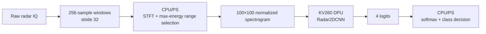

# Architecture

## End-to-end partition



The programmable-logic boundary starts at the normalized spectrogram. Raw IQ
windowing and STFT processing remain on the Arm processing system for the first
deployment version.

## DPU-friendly CNN

Input: `[N, 1, 100, 100]`

```text
Conv2d(1 → 16, 3×3) + BatchNorm + ReLU
MaxPool2d(2×2)                                  100 → 50
Conv2d(16 → 32, 3×3) + BatchNorm + ReLU
MaxPool2d(2×2)                                   50 → 25
Conv2d(32 → 64, 3×3) + BatchNorm + ReLU
MaxPool2d(2×2)                                   25 → 12
Conv2d(64 → 64, 3×3) + BatchNorm + ReLU
AvgPool2d(12×12)                                 12 → 1
Conv2d(64 → 4, 1×1)
Flatten                                             → 4 logits
```

Classes are Drone, Bird, Human, and CornerReflector.

## Hardware/software co-design result

The original `Linear(64 → 4)` classifier compiled to the CPU path. Replacing it
with an equivalent `1×1 Conv2d(64 → 4)` classifier produced a real DPU subgraph:

```text
USER → DPU → CPU
```

This operator-level change is the central co-design finding of the project.

## DPU and HLS paths

| Path | Role | Status |
|---|---|---|
| Vitis AI DPU | Main deployment | Quantized and compiled; board execution pending |
| Custom HLS CNN | Optional accelerator | Host-float equivalence passed; fixed-point synthesis pending |

The HLS design folds BatchNorm into convolution weights and implements the same
1×1 classifier. Its direct nested-loop implementation prioritizes readability;
line buffers, streaming, tiling, and channel parallelism are future work.

## Validation boundary

Window-level stride32 validation is retained as the engineering/MVP benchmark.
The official record-wise pipeline assigns every eligible source row by
`row_index % 3`: remainder 0 to train, 1 to validation, and 2 to test. All
windows inherit their source row's assignment, preventing cross-split overlap.
