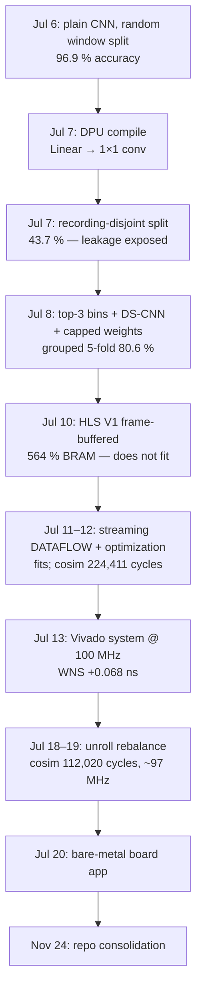

# How the project evolved

This page records the main decisions in order: what was tried, what the
evidence showed, and what changed as a result. Dates are 2026 and come from
the timestamps of the result files. Every number links to a file still in the
repository.

## Phase 1: first model and a number that was too good (6–7 Jul)

- The raw file holds 130 recordings. After the length check, 59 can produce
  256-sample windows. The first window set used a large stride. Stride 32 then
  increased the data to about 1,700 windows.
- The first model was a plain 4-layer CNN (`Radar2DCNN`). Its input was the
  single range bin with the most energy, and windows were split **at random**.
- Class imbalance was attacked three ways (`outputs/real/train_max_4class*`).
  Full class balancing collapsed to 10.1 % accuracy. A weighted sampler gave
  89.9 %. With stride 32 the model reached 97.70 % (sampler), and the
  DPU-friendly variant reached **96.93 %** (`outputs/real/train_max_stride32_4class_dpu/`).

## Phase 2: the DPU route (7 Jul)

- The model was exported to ONNX (max error 2.6e-6, `outputs/evidence/onnx_validation.json`),
  INT8-quantized with Vitis AI 3.5, and compiled for `DPUCZDX8G_ISA1_B4096`.
- The first compile (artifact since removed) put the `Linear` classifier on the CPU.
  Replacing it with an equivalent **1×1 convolution** gave a proper
  USER → DPU → CPU partition (`outputs/real/compiled_kv260_dpu/`). Every later
  model kept the 1×1-conv head.
- This DPU artifact was never rebuilt for the final DS-CNN. The DPU path still
  runs the Phase 1 network.

## Phase 3: finding the leakage (7 Jul)

- Windows 32 samples apart are almost the same image, so a random split puts
  near-copies of training data in the test set.
- A strict row-disjoint split (row index mod 3) dropped the same pipeline to
  **43.74 %** accuracy and 52.79 % macro-F1 (`outputs/recordwise/comparison.md`).
  From then on, every result is recording-disjoint, and overlap is checked in
  code.

## Phase 4: building a model that holds up (8 Jul)

Changes tried, each scored on a grouped stratified split (0.70 / 0.15 / 0.15, seed 42):

| Change | Why | Effect |
|---|---|---|
| Top-3 energy bins averaged instead of the single max bin | the max bin jumps between neighbouring range cells | steadier images |
| Depthwise-separable `RadarDSCNN2D` (24,612 params) | about 10× fewer MACs; small enough to keep all weights on chip | made the HLS design feasible |
| Training-only augmentation | few independent recordings | less overfitting |
| Imbalance strategy | Drone is about 88 % of windows | see the table below |

Imbalance comparison (`outputs/imbalance_strategy_comparison/comparison.md`):

| Strategy | Window acc | Window macro-F1 |
|---|---:|---:|
| Strong inverse weights | 75.31 % | 54.81 % |
| Sampler only | 88.53 % | 59.55 % |
| **Capped weights (max 8)** | **94.01 %** | **64.03 %** |

A single split with only 9 test recordings is fragile, so grouped 5-fold
cross-validation became the main result: **80.57 ± 2.98 %** window accuracy,
**66.45 ± 5.29 %** macro-F1, and **86.67 %** at the recording level. The final
checkpoint was picked by validation macro-F1 (epoch 35).

## Phase 5: first hardware design that did not fit (10 Jul)

- **V1 frame-buffered HLS**: each layer writes its full output before the next
  layer starts. It was easy to verify and became the numerical reference, but
  it needs **1,625 BRAM_18K, 564 % of the device**
  (`reports/frame_buffered_vitis2025_1/`). The memory goes on feature maps, not
  weights, so pragmas cannot fix it.
- A host-float build of the kernel matched PyTorch, which confirmed layer
  order, padding and BatchNorm folding before any synthesis.

## Phase 6: streaming rewrite and the first optimization round (11–12 Jul)

- The design became one `DATAFLOW` region with FIFO streams between stages.
  Depthwise stages keep two line-buffer rows, and no full feature map is stored.
- It was built up step by step: stem only, then stem + DW1, then the full
  network. Each step was checked bit for bit against V1.
- The first full streaming synthesis **still did not fit**. Wide inter-stage
  tokens (up to 2,048 bits) were going into BRAM FIFOs, about 660 BRAM across
  the pipeline (noted in `v2_streaming/radar_cnn_stream.cpp`), and the LUT
  count was too high. Three changes followed, none of which changed any output bit:
  1. **Shift-register FIFOs**: a BRAM FIFO costs ceil(width/36) BRAM36
     whatever its depth.
  2. **Flattened depthwise loops** into one (row, col, channel-block) pipeline
     at II=1, removing the flush on every pixel (up to 55× fewer cycles per stage).
  3. **Re-banked pointwise weight ROMs** per output lane, which removed large
     multiplexers.
- Result, the **streaming baseline** (Vitis 2025.1, `reports/baseline_vitis2025_1/`):
  57 BRAM_18K and 1,174 DSP (94 %), with depthwise stages at one pixel per
  clock. The pointwise stages (8×4 tiles, 160,005 cycles each) set the pace.
  Co-simulation measured **224,411 cycles**.

## Phase 7: first integrated system (13 Jul)

- Zynq UltraScale+ block design with the accelerator on HPM0 (control) and
  HPC0 (data), interrupt on `pl_ps_irq0`.
- Timing met at **100 MHz, WNS +0.068 ns**, LUT 83 %, DSP 681
  (`6_hardware/vivado/baseline_100mhz/`). It works, but with almost no margin.

## Phase 8: rebalancing for throughput (18–19 Jul)

- Pointwise tiles widened from 8×4 to **8×8**, halving PW1/PW2 from 160,005 to
  80,005 cycles.
- Depthwise lanes cut (16/8/8/8 → 8/4/2/2). These stages had slack, and the
  cut freed DSPs (1,174 → 1,018 in C-synth).
- Moved to Vitis HLS 2022.2, built from a short path to avoid Windows MAX_PATH
  limits. The C-synth estimate is 80,056 cycles, and co-simulation measured
  **112,020 cycles**, half the baseline. The standalone IP routed at 7.021 ns,
  which misses the 150 MHz HLS target.
- The new system (`6_hardware/vivado/optimized/`) closes timing at ~97 MHz with
  **WNS +1.149 ns**. It uses fewer DSPs (599 vs 681) and more BRAM (57.5 vs
  25.5 tiles), and the frame time is **≈ 1.16 ms**.

## Phase 9: preparing the board (20 Jul)

- Bare-metal Cortex-A53 benchmark app (`7_deployment/kv260_baremetal/`): it
  handles DDR buffers and cache maintenance, starts the IP and polls for done,
  checks logits bit for bit, and times 10 + 100 runs.
- The board run itself is still pending.

## Phase 10: repository consolidation (24 Nov)

- The work was spread over several folders: a Desktop copy, a Vitis workspace,
  an HLS working folder kept on a short path to avoid Windows MAX_PATH limits,
  and two Vivado projects.
- The final reports, block designs, XSAs, generated driver and models were
  collected here. Duplicate source trees and obsolete scripts were removed.
- The folders were renumbered to follow the pipeline (`1_data` …
  `7_deployment`), and the docs were rewritten so every figure traces to a file.

## Lessons

- With overlapping windows, only a split by recording gives an honest score.
  Expect a large drop from a random split, and treat the drop as a finding.
- On FPGAs, the data movement decides whether a design fits. Pragmas only tune it.
- A float build of the HLS kernel plus a fixed operation order turns each
  hardware check into an exact comparison that points to one stage.
- Small operator choices, such as a 1×1 conv instead of `Linear`, decide
  whether a vendor accelerator can run the model at all.
